# App Delicia: Administrador y Empleado

`app19_jc_adm_emp_etl_ml_bi`

App Android (Kotlin + Jetpack Compose) para el **personal** de Pastelería Delicia. Es el ejemplo de punta a punta del curso de Desarrollo de Aplicaciones Móviles. Integra una API propia, una base de datos en la nube, trabajo sin señal, un pago con QR, un modelo de Machine Learning y un tablero de indicadores.

| Dato | Valor |
|---|---|
| Lenguaje | Kotlin |
| Interfaz | Jetpack Compose + Material 3 |
| Arquitectura | MVVM estricto: `model` / `viewmodel` / `view` |
| Android mínimo | 7.0 (API 24) |
| API | [api_delicia_node](https://github.com/u2008113935/api_delicia_node), publicada en Render |
| Base de datos | Neon Postgres `bd_delicia_crm` |

---

## 1. Alcance funcional

### Qué hace cada rol

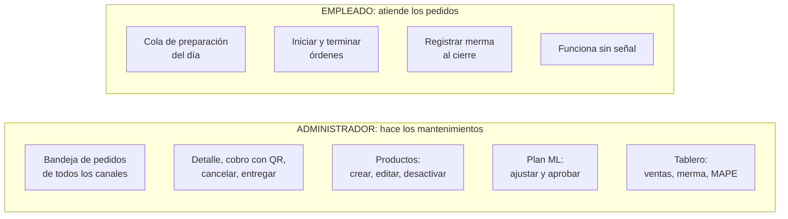

| Rol | Pestañas de la barra inferior | Puede trabajar sin señal |
|---|---|---|
| ADMIN | Pedidos, Productos, Plan ML, Tablero | No: cobrar o aprobar necesita confirmación del servidor |
| EMPLEADO | Cola, Merma | **Sí**: los cambios se guardan en el celular y se envían después |
| CLIENTE | La app lo rechaza: usa la web o la App Cliente | |

### Lo que está fuera de alcance

- Registro de clientes y catálogo para clientes: lo hacen la web React y la App Cliente.
- Entrenamiento del modelo: se hace en Google Colab y escribe sus resultados en Neon.
- Pago real: Banco Andino está **simulado** para la clase.

---

## 2. Arquitectura general del ecosistema

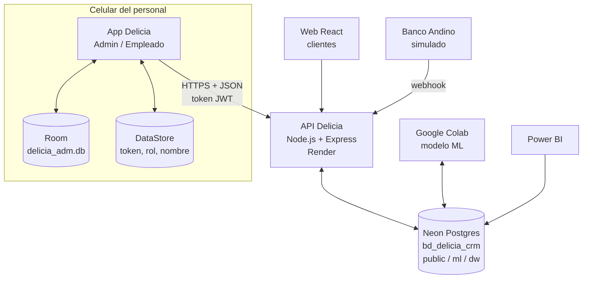

**Idea clave:** la app **nunca** se conecta directo a la base de datos. Todo pasa por la API, que valida el rol y las reglas del negocio.

---

## 3. Qué es MVVM y cómo se aplica aquí

MVVM separa la app en tres capas. Cada una tiene **una sola responsabilidad** y solo conoce a la capa de abajo.

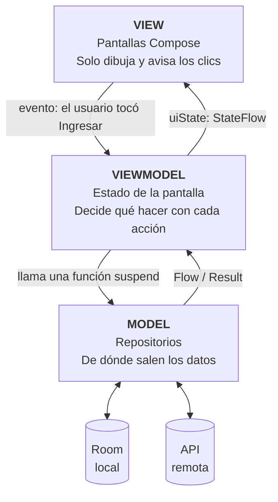

| Capa | Paquete | Responsabilidad | Lo que **no** hace |
|---|---|---|---|
| **View** | `view/` | Dibuja el `uiState` y envía eventos | No llama a la API ni a Room |
| **ViewModel** | `viewmodel/` | Guarda el estado, valida y llama al repositorio | No conoce Compose ni el contexto de Android |
| **Model** | `model/` | Obtiene y guarda datos (API, Room, DataStore) | No sabe qué pantalla lo usa |

Este proyecto **no** usa capa `domain` (casos de uso): la lógica del negocio vive en la API y la app se mantiene en tres capas.

### Flujo unidireccional de datos

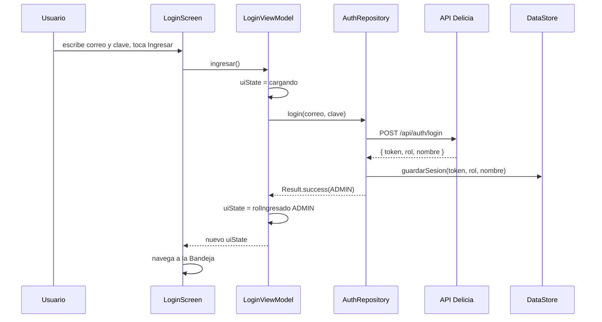

El estado **baja** (ViewModel → View) y los eventos **suben** (View → ViewModel). La pantalla nunca cambia datos por su cuenta.

---

## 4. Estructura de carpetas

```
app/src/main/java/com/example/app19_jc_adm_emp_etl_ml_bi/
│
├── App19Application.kt          Crea el AppContainer al abrir la app
├── MainActivity.kt              Única Activity: aplica el tema y muestra DeliciaApp
│
├── model/                       ── CAPA MODEL ──
│   ├── AppContainer.kt          Inyección de dependencias manual
│   ├── SyncWorker.kt            Envía en segundo plano lo hecho sin señal
│   ├── Fechas.kt                Fechas en formato de la API (AAAA-MM-DD)
│   ├── enums/                   Estados y roles: los mismos valores que la base
│   ├── local/                   Room (tablas locales) y DataStore (sesión)
│   │   ├── entity/
│   │   └── dao/
│   ├── remote/                  Retrofit: contrato con la API
│   │   └── dto/
│   └── repository/              Une local + remoto; lo único que ve el ViewModel
│
├── viewmodel/                   ── CAPA VIEWMODEL ──
│   ├── Errores.kt               Traduce errores de red a mensajes claros
│   ├── splash/  login/  sesion/
│   ├── admin/                   Un ViewModel por pantalla del administrador
│   └── empleado/                Un ViewModel por pantalla del empleado
│
└── view/                        ── CAPA VIEW ──
    ├── DeliciaApp.kt            Scaffold: barra superior e inferior según el rol
    ├── navigation/              Rutas y grafo de navegación
    ├── theme/                   Colores, tipografía y tema
    ├── components/              Piezas reutilizables
    ├── splash/  login/
    ├── admin/                   Pantallas del administrador
    └── empleado/                Pantallas del empleado
```

---

## 5. Capa MODEL, archivo por archivo

### 5.1 Arranque y dependencias

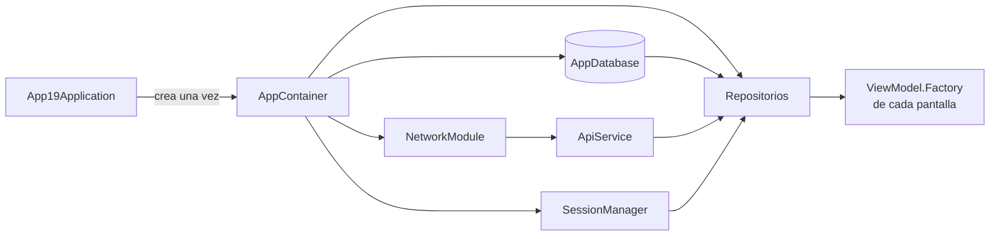

| Archivo | Qué hace |
|---|---|
| `App19Application.kt` | Clase que Android crea antes que cualquier pantalla. Construye el `AppContainer` y programa el `SyncWorker` por si quedó algo pendiente |
| `model/AppContainer.kt` | Crea **una sola vez** la base Room, el `SessionManager`, Retrofit y todos los repositorios. Usa `by lazy` para crearlos recién cuando alguien los pide. Es la inyección de dependencias sin librerías |
| `model/Fechas.kt` | `hoy()`, `manana()` y `desplazar(días)` con `Calendar`, porque `LocalDate` necesita Android 8 y el mínimo es 7 |

Cada ViewModel tiene un `companion object Factory` que pide sus repositorios al contenedor:

```kotlin
val Factory = viewModelFactory {
    initializer {
        val app = this[APPLICATION_KEY] as App19Application
        BandejaViewModel(app.container.pedidoRepository)
    }
}
```

### 5.2 `enums/`: el vocabulario compartido

Los valores son **idénticos** a los de la base de datos y la API. Así Gson los convierte sin traducción.

| Archivo | Valores |
|---|---|
| `Rol.kt` | `ADMIN`, `EMPLEADO`. Un `CLIENTE` llega como `null` y la app lo rechaza |
| `EstadoPedido.kt` | `PEND_PAGO`, `PAGADO`, `EN_PREPARACION`, `LISTO`, `ENTREGADO`, `CANCELADO` |
| `EstadoOrden.kt` | `PLANIFICADA`, `EN_PROCESO`, `TERMINADA` |
| `EstadoSync.kt` | `PENDIENTE`, `ENVIANDO`, `SINCRONIZADO`, `ERROR`: estado de una operación hecha sin señal |

### 5.3 `local/`: lo que se guarda en el celular

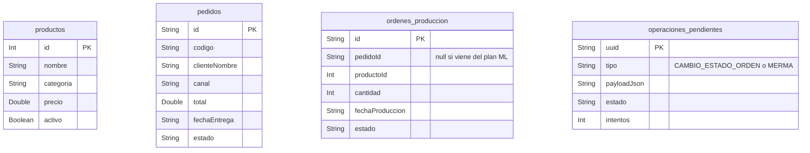

| Archivo | Qué hace |
|---|---|
| `AppDatabase.kt` | Base Room `delicia_adm.db` con las 4 tablas. Patrón Singleton: una sola instancia para toda la app |
| `Converters.kt` | Convierte los enums a texto para guardarlos en Room y de vuelta |
| `SessionManager.kt` | DataStore con `token`, `rol` y `nombre`. Expone `Flow` para que el Splash decida a dónde ir |
| `entity/ProductoEntity.kt` | Copia local del catálogo |
| `entity/PedidoEntity.kt` | Copia local de la bandeja: se ve aunque no haya señal |
| `entity/OrdenProduccionEntity.kt` | Cola del empleado |
| `entity/OperacionPendienteEntity.kt` | **Cola offline**: cada acción del empleado sin señal, con su `uuid` |
| `dao/ProductoDao.kt` | `observarTodos()` como `Flow`, `buscarPorId()` y `guardarTodos()` |
| `dao/PedidoDao.kt` | `observarTodos()`, `observarPorEstado()`, `buscarPorId()`, `guardarTodos()` |
| `dao/OrdenProduccionDao.kt` | `observarCola(fecha)` ordenada por hora de entrega y `actualizarEstado()` |
| `dao/OperacionPendienteDao.kt` | `obtenerPorEnviar()`, `actualizarEstado()`, `limpiarSincronizadas()` y `observarCantidadPendientes()` para la franja roja o verde |

**¿Por qué `Flow`?** Cuando Room cambia, el `Flow` emite la lista nueva y la pantalla se redibuja sola. Nadie tiene que "refrescar a mano".

### 5.4 `remote/`: el contrato con la API

| Archivo | Qué hace |
|---|---|
| `NetworkModule.kt` | Arma OkHttp (interceptor del token, registro en Logcat y tiempos de espera de 60 s por Render) y Retrofit con `BuildConfig.BASE_URL` |
| `AuthInterceptor.kt` | Agrega `Authorization: Bearer <token>` a **todas** las peticiones, sin repetirlo en cada función |
| `ApiService.kt` | Interfaz Retrofit: una función `suspend` por endpoint |
| `dto/*.kt` | Clases con la forma exacta del JSON. `@SerializedName` une `cliente_nombre` (API) con `clienteNombre` (Kotlin) |

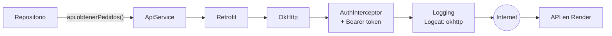

**Endpoints que usa la app**

| Función | Método y ruta | Rol |
|---|---|---|
| `login` | `POST api/auth/login` | Todos |
| `obtenerProductos`, `crearProducto`, `actualizarProducto` | `GET / POST / PUT api/productos` | ADMIN |
| `obtenerPedidos`, `obtenerPedido` | `GET api/pedidos`, `GET api/pedidos/{id}` | ADMIN |
| `cambiarEstadoPedido` | `PATCH api/pedidos/{id}/estado` | ADMIN / EMPLEADO |
| `generarQr`, `consultarPago`, `simularPago` | `POST api/pagos/qr`, `GET api/pagos/{id}`, `POST api/pagos/{id}/simular` | ADMIN |
| `obtenerOrdenes` | `GET api/produccion/ordenes?fecha=` | EMPLEADO |
| `cambiarEstadoOrden` | `PATCH api/produccion/ordenes/{id}/estado` | EMPLEADO |
| `aprobarPlan` | `POST api/produccion/plan` | ADMIN |
| `registrarMerma` | `POST api/merma` | EMPLEADO |
| `obtenerProduccionSugerida` | `GET api/ml/produccion-sugerida?fecha=` | ADMIN |
| `obtenerTablero` | `GET api/kpis?desde=&hasta=` | ADMIN |

### 5.5 `repository/`: la única puerta del ViewModel

Hay dos estrategias, según si la pantalla puede funcionar sin señal o no.

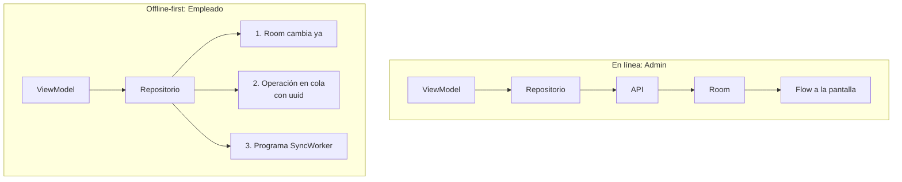

| Archivo | Estrategia | Qué hace |
|---|---|---|
| `AuthRepository.kt` | En línea | `login()` guarda la sesión en DataStore. Si el rol es CLIENTE, lanza "Esta app es solo para el personal" |
| `PedidoRepository.kt` | Caché | `refrescar()` trae de la API y guarda en Room. `obtenerDetalle()` y `cambiarEstado()` necesitan señal |
| `ProductoRepository.kt` | Caché | Lista desde Room. `guardar()` crea o edita en la API y actualiza Room |
| `PagoRepository.kt` | En línea | `generarQr()`, `consultarPago()`, `simularConfirmacion()` |
| `ProduccionRepository.kt` | **Offline-first** | `cambiarEstado()` actualiza Room, deja la operación en cola y programa la sincronización |
| `MermaRepository.kt` | **Offline-first** | `registrar()` solo encola: la merma llega a la API cuando haya señal |
| `MlRepository.kt` | En línea | Producción sugerida por el modelo |
| `AnaliticaRepository.kt` | En línea | Tablero de KPIs |

Todas las funciones devuelven `Result<T>` con `runCatching { }`: el ViewModel decide con `onSuccess` y `onFailure`, sin `try/catch` en cada pantalla.

### 5.6 `SyncWorker.kt`: trabajo sin señal

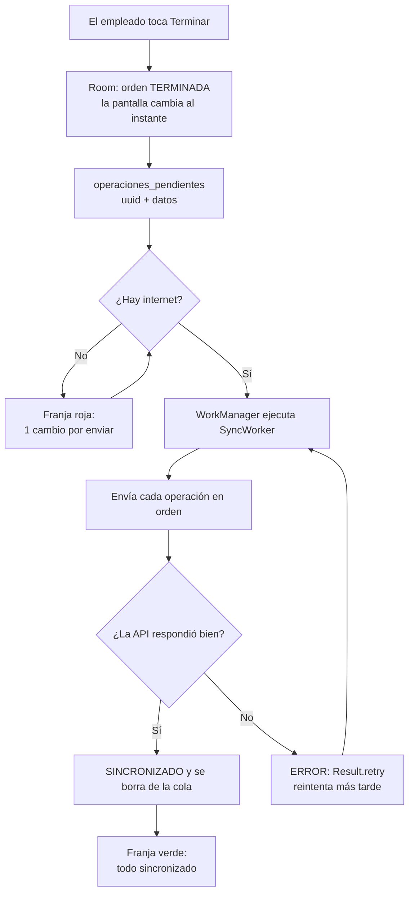

**¿Qué pasa si una operación se envía dos veces?** Cada una lleva un `uuid` que la API guarda. Si llega repetida, la API responde igual pero no la vuelve a aplicar. Esto se llama **idempotencia**.

---

## 6. Capa VIEWMODEL, archivo por archivo

Todos siguen el mismo patrón:

```kotlin
private val _uiState = MutableStateFlow(MiUiState())          // privado: solo el ViewModel lo cambia
val uiState: StateFlow<MiUiState> = _uiState.asStateFlow()   // público: la pantalla solo lo lee

fun accion() {
    viewModelScope.launch {                                   // corrutina que muere con la pantalla
        _uiState.update { it.copy(cargando = true) }
        repo.algo()
            .onSuccess { r -> _uiState.update { it.copy(cargando = false, dato = r) } }
            .onFailure { e -> _uiState.update { it.copy(cargando = false, error = mensajeDeError(e)) } }
    }
}
```

| Archivo | Pantalla | Responsabilidad |
|---|---|---|
| `Errores.kt` | Todas | `mensajeDeError(e)`: lee el `{ "error": "..." }` de la API o traduce 401, 403 y sin conexión |
| `splash/SplashViewModel.kt` | Splash | Lee el token y el rol guardados y decide: Login, Admin o Empleado |
| `login/LoginUiState.kt` | Login | Correo, clave, mostrar clave, cargando, error, rol ingresado |
| `login/LoginViewModel.kt` | Login | Valida campos vacíos y llama a `AuthRepository.login()` |
| `sesion/SesionViewModel.kt` | Barra superior | Nombre del usuario y `cerrarSesion()` |
| `admin/BandejaUiState.kt`, `BandejaViewModel.kt` | Bandeja | Combina filtro + pedidos de Room + estado de carga con `flatMapLatest` y `combine` |
| `admin/PedidoDetalleViewModel.kt` | Detalle | Carga el detalle y decide qué botones mostrar según el estado (`AccionPedido`) |
| `admin/CobroQrViewModel.kt` | Cobro QR | Genera el QR, **consulta cada 3 segundos** hasta CONFIRMADO o RECHAZADO, y simula el banco |
| `admin/ProductosViewModel.kt` | Productos | Lista desde Room y refresca desde la API |
| `admin/ProductoFormViewModel.kt` | Formulario | Nuevo (id = -1) o edición; valida nombre y precio |
| `admin/PlanProduccionViewModel.kt` | Plan ML | Muestra lo sugerido, deja editar cada cantidad y aprueba |
| `admin/TableroUiState.kt`, `TableroViewModel.kt` | Tablero | Periodo de 7 o 30 días y KPIs |
| `empleado/ColaViewModel.kt` | Cola | Órdenes de hoy + cantidad pendiente de sincronizar + aviso sin señal |
| `empleado/OrdenDetalleViewModel.kt` | Orden | Lee de Room y cambia el estado offline |
| `empleado/MermaViewModel.kt` | Merma | Formulario con validación; guarda aunque no haya señal |

**`SavedStateHandle`**: los ViewModels de detalle reciben el `id` de la ruta (`admin/pedido/{id}`) sin que la pantalla se lo pase a mano.

---

## 7. Capa VIEW, archivo por archivo

### 7.1 Navegación

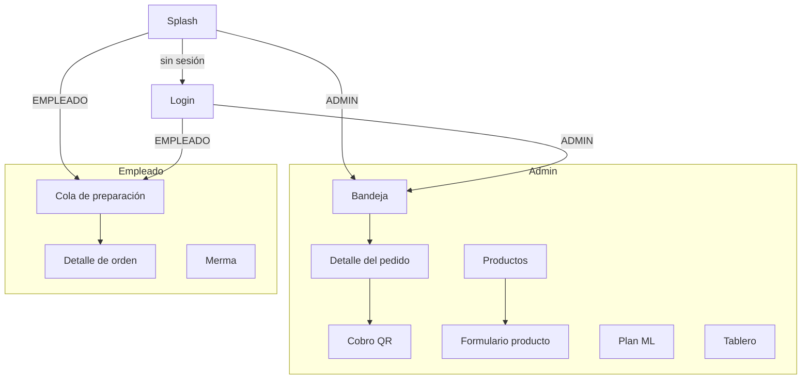

| Archivo | Qué hace |
|---|---|
| `navigation/Rutas.kt` | Nombres de las rutas (`admin/bandeja`, `empleado/cola`...) y funciones para armar las que llevan datos |
| `navigation/DeliciaNavGraph.kt` | `NavHost` con todas las pantallas. Splash y Login borran el historial para que "Atrás" no regrese al login |
| `DeliciaApp.kt` | `Scaffold` con la barra superior (título, volver, nombre, salir) y la barra inferior con **pestañas según el rol**, que solo aparece en las pantallas principales |

### 7.2 Pantallas

| Archivo | Rol | Qué muestra |
|---|---|---|
| `splash/SplashScreen.kt` | Todos | Logo mientras decide a dónde ir |
| `login/LoginScreen.kt` | Todos | Correo, clave con botón Ver/Ocultar, mensaje de error |
| `admin/BandejaScreen.kt` | ADMIN | Filtros por estado (FilterChip) y tarjetas de pedido |
| `admin/PedidoDetalleScreen.kt` | ADMIN | Productos, producción, pago, historial y botones de acción. Se recarga al volver del cobro (`LifecycleEventEffect ON_RESUME`) |
| `admin/CobroQrScreen.kt` | ADMIN | QR, espera de confirmación y botón de simulación del banco |
| `admin/ProductosScreen.kt` | ADMIN | Lista (inactivos en gris) y botón flotante Nuevo |
| `admin/ProductoFormScreen.kt` | ADMIN | Nombre, categoría, precio y activo |
| `admin/PlanProduccionScreen.kt` | ADMIN | Hoy / Mañana, sugerido con rango y cantidad editable |
| `admin/TableroScreen.kt` | ADMIN | KPIs en pares y dos gráficos de barras |
| `empleado/ColaPreparacionScreen.kt` | EMPLEADO | Franja de sincronización y tarjetas con Iniciar / Terminar |
| `empleado/OrdenDetalleScreen.kt` | EMPLEADO | Detalle grande de la orden y botón de avance |
| `empleado/MermaScreen.kt` | EMPLEADO | Producto, cantidad y motivo |

### 7.3 Componentes reutilizables

| Archivo | Qué es |
|---|---|
| `components/EstadoChip.kt` | Etiqueta de color para cada estado de pedido u orden |
| `components/KpiCard.kt` | Tarjeta de indicador con variación en verde o rojo (en la merma, subir es malo) |
| `components/BarChart.kt` | Barras horizontales hechas con `Box`, sin librerías de gráficos |
| `components/QrImage.kt` | Convierte el texto del banco en imagen QR con zxing |
| `components/SyncBanner.kt` | Franja roja (cambios por enviar) o verde (todo sincronizado) |
| `components/LoadingError.kt` | `Cargando`, `MensajeError` con Reintentar y `MensajeVacio` |
| `theme/Color.kt`, `Theme.kt`, `Type.kt` | Paleta chocolate y rosa. `dynamicColor = false` para que siempre se vea con la marca |

---

## 8. Flujos de negocio completos

### 8.1 Del pedido a la entrega

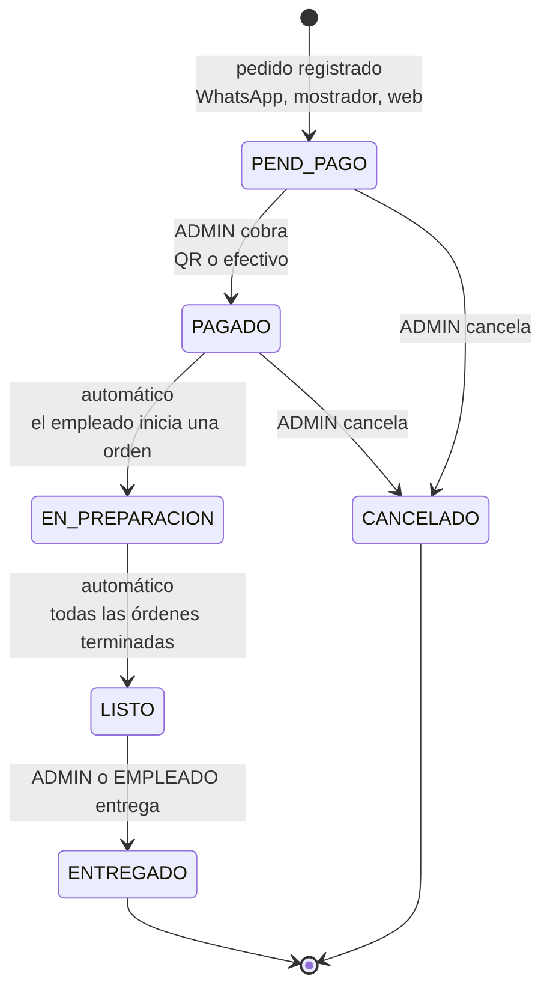

### 8.2 Cobro con QR de Banco Andino

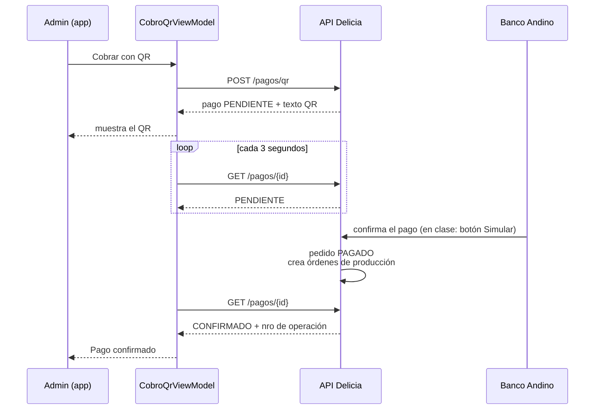

### 8.3 Machine Learning: el modelo propone, el admin decide

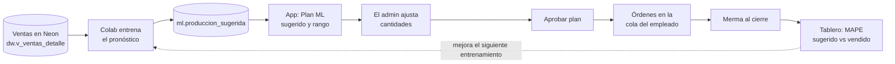

---

## 9. Alcance técnico

| Tema | Cómo se resolvió |
|---|---|
| Arquitectura | MVVM en tres paquetes, ViewModel por pantalla, `UiState` inmutable con `data class` y `copy()` |
| Estado | `StateFlow` + `collectAsStateWithLifecycle()`: deja de escuchar cuando la app pasa a segundo plano |
| Asincronía | Corrutinas con `viewModelScope` y funciones `suspend` en Retrofit y Room |
| Dependencias | Contenedor manual (`AppContainer`) + `viewModelFactory`, sin Hilt |
| Red | Retrofit 3 + Gson + OkHttp con interceptor de token y registro en Logcat |
| Persistencia | Room 2.8 (4 tablas) + DataStore Preferences para la sesión |
| Offline | Cola de operaciones + WorkManager con restricción de red y reintentos |
| Idempotencia | `uuid` por operación, validado por la API |
| Navegación | Navigation Compose con rutas de texto y argumentos tipados |
| Seguridad | JWT en DataStore, interceptor central, rechazo del rol CLIENTE, sin claves en el código |
| Configuración | `BASE_URL` en `BuildConfig` desde `build.gradle.kts` |
| QR | zxing core (sin cámara: solo genera la imagen) |
| Compatibilidad | Android 7.0+: `Calendar` en lugar de `java.time` |

**Versiones principales** (`gradle/libs.versions.toml`): AGP 9.1, Kotlin 2.2, Compose BOM, Navigation 2.9, Room 2.8, Retrofit 3.0, DataStore 1.2, WorkManager 2.11, zxing 3.5.

---

## 10. Cómo ejecutarla

### Requisitos
- Android Studio reciente
- La API Delicia funcionando: en Render o local

### Elegir a qué API conectarse

En `app/build.gradle.kts`, deja **una sola** línea activa:

```kotlin
// Render (internet, wifi o datos)
buildConfigField("String", "BASE_URL", "\"https://api-delicia-node.onrender.com/\"")

// Local con el celular por USB: además ejecutar  adb reverse tcp:8000 tcp:8000
// buildConfigField("String", "BASE_URL", "\"http://127.0.0.1:8000/\"")

// Emulador con la API en la PC
// buildConfigField("String", "BASE_URL", "\"http://10.0.2.2:8000/\"")
```

Después: **Sync Now** y **Run**.

> Render gratuito se duerme tras 15 minutos sin uso. La primera petición tarda unos 50 segundos; por eso la app espera hasta 60 segundos.

### Usuarios de prueba

| Rol | Correo | Clave |
|---|---|---|
| ADMIN | `admin@delicia.pe` | `Admin2026*` |
| EMPLEADO | `luis@delicia.pe` | `Empleado2026*` |

> Cambiar las claves antes de mostrar la app fuera de clase.

### Recorrido de demostración

1. **ADMIN**: abre un pedido en Pend. pago y elige Cobrar con QR, luego Simular pago. El pedido pasa a Pagado.
2. **EMPLEADO**: en Cola, toca Iniciar y luego Terminar. El pedido pasa solo a En preparación y luego a Listo.
3. **Modo avión**: el empleado avanza otra orden y registra merma. Aparece la franja roja. Quita el modo avión y la franja se pone verde.
4. **ADMIN**: entrega el pedido, aprueba el Plan ML de mañana y revisa el Tablero.

---

## 11. Diagnóstico de problemas

| Síntoma | Dónde mirar | Causa frecuente |
|---|---|---|
| "Sin conexión con la API" | Logcat, filtro `okhttp` | `UnknownHostException`: el celular sin internet. `Failed to connect 127.0.0.1`: falta `adb reverse` |
| "Correo o contraseña incorrectos" | Respuesta de la API | Falta el asterisco de la clave o no se ejecutó el script de usuarios |
| "Esta app es solo para el personal" | | Se ingresó con una cuenta CLIENTE |
| Cola o Plan ML vacíos | Fecha | No hay órdenes ni pronóstico para la fecha de hoy |
| La franja roja no baja | Logcat, filtro `WM-` | WorkManager espera señal o la API rechazó la operación |
| El primer login tarda mucho | | Render despertando: es normal |

**Logcat** muestra cada petición y respuesta en modo debug:
```
--> POST https://api-delicia-node.onrender.com/api/auth/login
<-- 200 OK (1234ms)
```

---

## 12. Glosario

| Término | Significado |
|---|---|
| **MVVM** | Model-View-ViewModel: separa datos, lógica de pantalla y dibujo |
| **UiState** | `data class` con todo lo que la pantalla necesita para dibujarse |
| **StateFlow** | Valor observable que siempre tiene un estado actual |
| **Flow** | Secuencia de valores en el tiempo: Room emite cada vez que cambia una tabla |
| **Corrutina** | Tarea que espera (red, base) sin congelar la pantalla |
| **Repository** | Clase que decide si los datos vienen de Room o de la API |
| **DTO** | Clase con la forma del JSON de la API |
| **Entity** | Clase con la forma de una tabla de Room |
| **DAO** | Interfaz con las consultas SQL de Room |
| **Offline-first** | Guardar primero en el celular y enviar después |
| **WorkManager** | Ejecuta tareas en segundo plano aunque se cierre la app |
| **Idempotencia** | Repetir una operación no cambia el resultado |
| **JWT** | Token firmado con el usuario y su rol |
| **Interceptor** | Código que se ejecuta en cada petición HTTP (agrega el token) |
| **MAPE** | Error porcentual promedio del pronóstico frente a lo vendido |

---

## Repositorios relacionados

- API: [u2008113935/api_delicia_node](https://github.com/u2008113935/api_delicia_node)
- Base de datos: Neon `bd_delicia_crm` (scripts en la carpeta `sql/` de la API)
